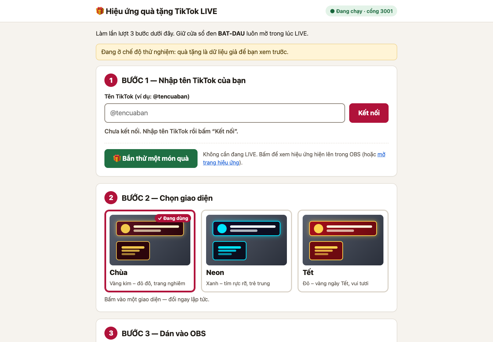
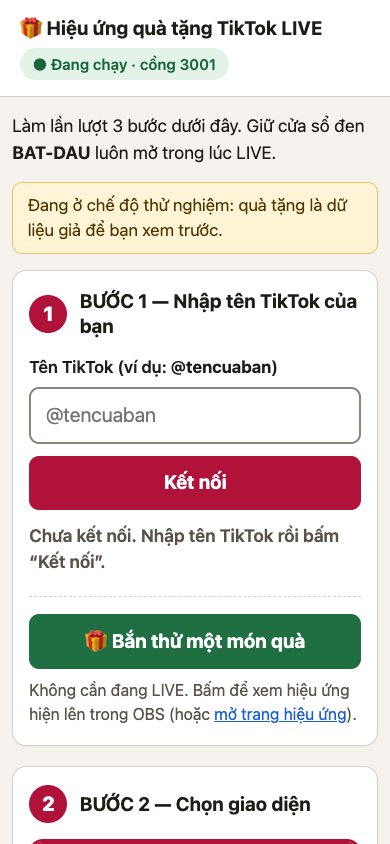
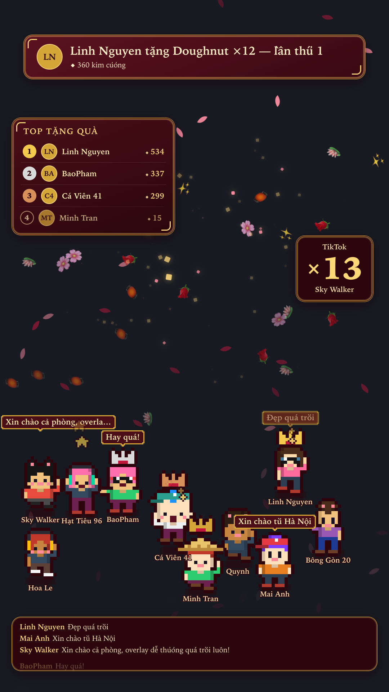
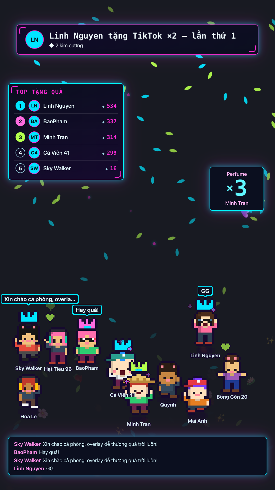
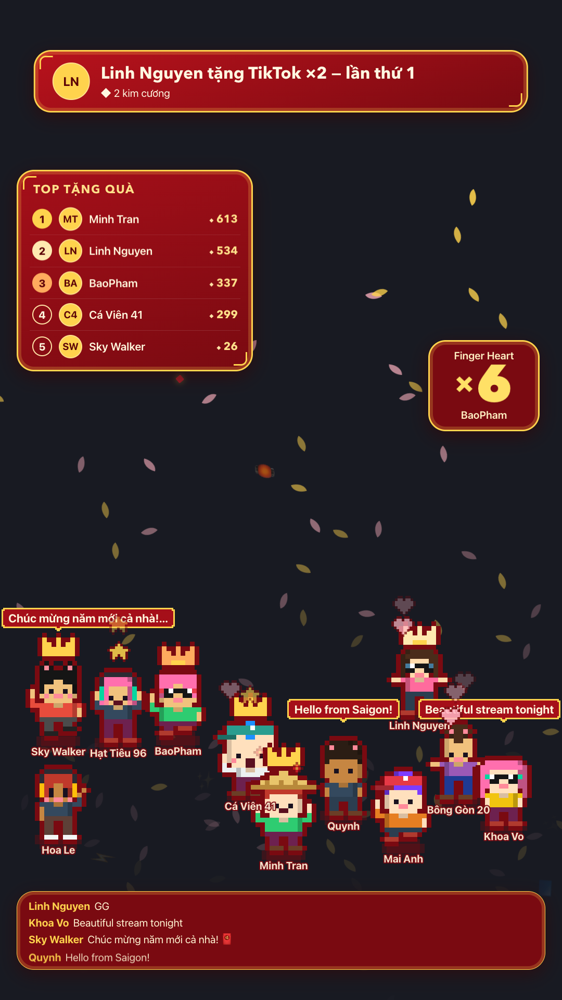
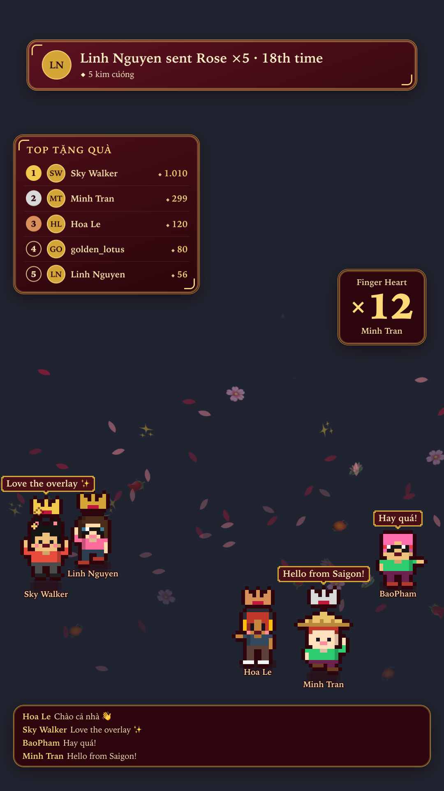
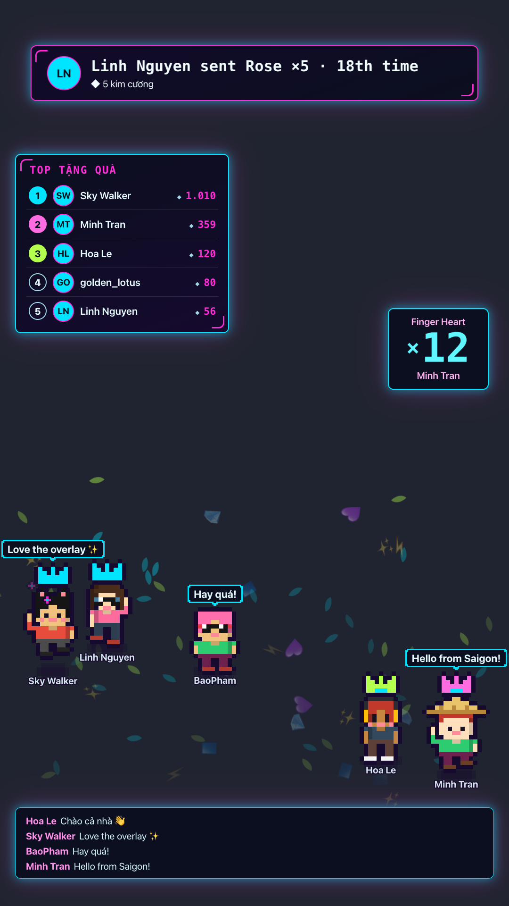
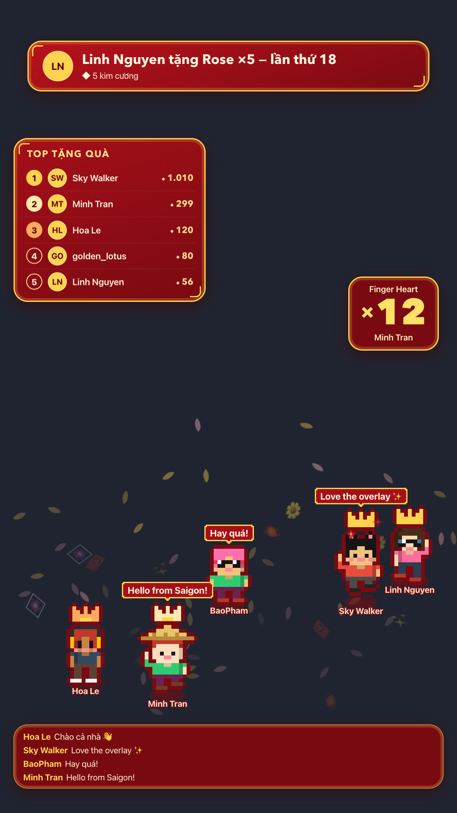

# TikTok LIVE Overlay Engine

## Dành cho người không biết kỹ thuật

Chương trình này hiện hiệu ứng đẹp lên màn hình LIVE mỗi khi có người tặng quà cho bạn. Bạn chỉ cần bấm đúp chuột, không cần gõ lệnh.

1. **Cài Node.js (chỉ làm một lần).** Vào trang **https://nodejs.org**, bấm nút tải bản **LTS** (nút màu xanh lá), mở file vừa tải và bấm *Tiếp tục / Next* cho đến khi xong.
2. **Mở thư mục chương trình** (thư mục chứa file này).
3. **Bấm đúp vào file khởi động:**
   - Máy **Mac**: bấm đúp **`BAT-DAU.command`**. Nếu máy báo *“không thể mở vì nhà phát triển không xác định”*: bấm **chuột phải** vào file → **Mở** → **Mở**.
   - Máy **Windows**: bấm đúp **`BAT-DAU.bat`**. Nếu hiện bảng xanh *“Windows đã bảo vệ máy tính”*: bấm **Thông tin thêm** → **Vẫn chạy**.
4. **Đợi một chút.** Lần đầu, chương trình tự tải thêm vài thành phần (cần Internet, khoảng 1–3 phút). Sau đó trình duyệt tự mở **Bảng điều khiển**. Một cửa sổ đen hiện dòng **“ĐANG CHẠY! ĐỪNG ĐÓNG CỬA SỔ NÀY”** — hãy để nguyên cửa sổ đó trong suốt buổi LIVE.
5. **Bước 1 trên Bảng điều khiển:** gõ tên TikTok của bạn (ví dụ `@tencuaban`) rồi bấm **Kết nối**. Bạn phải đang bật LIVE thì mới kết nối được. Muốn xem thử trước? Bấm **🎁 Bắn thử một món quà** — không cần đang LIVE.
6. **Bước 2:** bấm chọn một giao diện: **Chùa**, **Neon** hoặc **Tết**. Đổi ngay lập tức.
7. **Bước 3:** bấm **Sao chép** để chép đường dẫn. Trong **OBS**: ở khung **Nguồn** bấm **+** → **Trình duyệt** → dán đường dẫn vào ô **URL** → đặt **Chiều rộng 1080**, **Chiều cao 1920** → **OK**.
8. **Khi LIVE xong:** đóng cửa sổ đen (hoặc bấm **Ctrl + C** trong cửa sổ đó). Lần sau chỉ cần làm lại từ bước 3. Nếu bảng điều khiển báo đổi cổng (ví dụ từ 3000 sang 3001), hãy dán lại đường dẫn mới vào OBS.

**Nhân vật pixel:** mỗi người xem vào phòng có một nhân vật pixel nhỏ đi lại ở cuối màn hình — vẫy tay chào nhau, nhảy khi có người tặng quà, nói chuyện khi bình luận, đội vương miện nếu đứng trong top tặng quà. Bật/tắt, chọn số nhân vật tối đa và cỡ nhân vật ở mục **“Nhân vật pixel”** trên Bảng điều khiển; bấm **👾 Bắn thử nhân vật** để xem thử mà không cần LIVE.

**Gặp lỗi?** Bảng điều khiển luôn ghi lỗi bằng tiếng Việt kèm nút **Thử lại**. Nếu thấy *“Không tìm thấy phòng live — bạn đã bật LIVE chưa?”*, hãy bật LIVE trên TikTok trước rồi bấm **Thử lại**. Nếu OBS không hiện gì: kiểm tra cửa sổ đen còn mở, rồi trong OBS bấm chuột phải vào nguồn → **Làm mới**.

| Bảng điều khiển (máy tính) | Trên điện thoại | Hiệu ứng khi chưa có quà |
| --- | --- | --- |
|  |  |  |

---

## Developer documentation

A local Node server that connects to a TikTok LIVE room. It turns gifts, comments, likes, follows, shares and joins into one normalized event stream and sends it over WebSocket to an overlay page that runs inside an **OBS Browser Source**. You run the show from a small control panel.

```
TikTok live --(tiktok-live-connector)--> Node server --> WebSocket fanout --> /overlay (OBS Browser Source)
                                              |                                  ^
                                              +--> /panel (operator UI) ---------+
```

| Surface    | What it is                                                                    |
| ---------- | ----------------------------------------------------------------------------- |
| `/overlay` | The page OBS loads. Transparent background, no chrome, no scrollbars.         |
| `/panel`   | Control panel: connect a room, switch theme, send test gifts, clear state, mute, start or stop the mock stream, live event log. |
| `/health`  | JSON status: mode, TikTok connection state, WS client count, event counters.  |
| `/ws`      | WebSocket stream. The server only pushes; it ignores anything clients send.   |
| `/api/*`   | JSON control API (see below).                                                 |

The overlay has five layers, all driven by the event stream:

1. **Banner**: a rounded panel at the top center, filled from a template (`{user} sent {gift} {unit} · {ordinal} time` → "Linh Nguyen sent Rose ×5 · 18th time"). Banners queue and never overlap. Each one shows for about 4 s. If more than 6 are waiting, the oldest ones are dropped.
2. **Leaderboard**: the top 5 gifters by diamonds this session, with medal or number, avatar (initials if there is no avatar), name and total. When the order changes, rows slide to their new place (FLIP animation).
3. **Gift particles**: rose petals, gold sparkles or falling theme icons. Bigger gifts get more particles (12 for a 1-diamond gift, capped at 90 per burst and 160 on screen at once).
4. **Combo counter**: a big ×N number that counts up while a gift streak is running.
5. **Ticker**: the last 4 comments at the bottom. You can turn it off.
6. **Pixel characters**: every viewer gets their own retro pixel character that walks around a stage band above the ticker and reacts to what that viewer (and their neighbours) do. See [Pixel characters](#pixel-characters).

## Quick start

Requires Node ≥ 22. Tested on Node v24.14.0 / macOS.

**One-click launcher** (what non-technical users run): `BAT-DAU.command` (macOS) / `BAT-DAU.bat` (Windows). Both check that Node ≥ 22 exists (else print the nodejs.org link and pause), run `npm install` if dependencies are missing, then run `node src/launch.js`, which picks a free port starting at **3000** (3001, 3002… if busy), waits for `/health`, opens `/panel` in the default browser (`open` / `start`), and prints the overlay URL. Ctrl-C, SIGTERM or closing the window (SIGHUP) shuts down cleanly. Flags: `--no-open`, `--port=N`, `--mock` (env: `PORT`, `MOCK=1`, `NO_OPEN=1`). The launcher persists panel settings to `data/settings.json` (gitignored); a corrupt or invalid file is logged and ignored key by key, never fatal.

Developer entry point below (`npm start`) also auto-increments its port if `7373` is taken.

```bash
cd tiktok-live-overlay
npm install
MOCK=1 npm start
```

Then open `http://127.0.0.1:7373/panel` (control panel) and `http://127.0.0.1:7373/overlay` (what OBS will show). In mock mode, made-up gifts, streaks, comments and likes start flowing right away.

Environment variables:

| Var         | Default     | Meaning                                                                           |
| ----------- | ----------- | --------------------------------------------------------------------------------- |
| `PORT`      | `7373`      | HTTP/WS port (`0` = random). If busy, the next free port is used and printed.     |
| `HOST`      | `127.0.0.1` | Bind address. Leave it on loopback; the API has no authentication.                |
| `MOCK`      | unset       | `1` starts the mock event generator.                                              |
| `MOCK_RATE` | `2`         | Average mock events per second (0.2–50).                                          |

**Real mode:** run `npm start` without `MOCK`, open the panel, enter the creator's username (for example `@creator`) and click **Connect**. The creator must be LIVE at that moment. If the connection fails, the panel shows a clear error and the server keeps running. Example from an actual run with a username that does not exist: `Could not find a LIVE room (user offline, wrong username, or TikTok blocked the lookup)…`, returned as HTTP 502.

## OBS setup

1. Start the server (`npm start` or `MOCK=1 npm start`).
2. In OBS: **Sources → + → Browser** and give it a name.
3. Set **URL** to `http://127.0.0.1:7373/overlay`. Use your `PORT` if you changed it.
4. Set **Width 1080** and **Height 1920** (vertical canvas).
5. Turn **"Shutdown source when not visible" OFF**. Otherwise OBS closes the page and you miss events and leaderboard updates while the source is hidden.
6. Leave "Custom CSS" empty. The page is already transparent, so delete OBS's default `body { background-color: rgba(0,0,0,0); … }` or leave it, either works.
7. Optional: tick **"Control audio via OBS"** if you want the synthesized gift chime on its own mixer channel. Mute it from the panel with **Mute gift sounds**.

You can lock settings for a single Browser Source with URL parameters. They override the panel:

```
/overlay?theme=neon        # always neon, whatever the panel says
/overlay?ticker=0          # hide the comment ticker
/overlay?muted=1           # never play the chime
/overlay?characters=0      # never show the pixel characters
```

The layout works at any size from 1080×1920 down to 390 px wide (see `docs/shots/temple-390.png`).

## Theming

Themes are sets of CSS custom properties in `public/css/themes.css`. One attribute on `<html>` switches between them:

```html
<html data-theme="temple">   <!-- temple | neon | tet -->
```

| Theme    | Look                                                  |
| -------- | ----------------------------------------------------- |
| `temple` | Maroon and gold, double borders, ornate corner marks, serif display type |
| `neon`   | Near-black panels, cyan/magenta glow, monospace display type |
| `tet`    | Lunar New Year red and gold, rounded festive panels    |

To add a theme:

1. Copy one `html[data-theme='…'] { … }` block in `themes.css` and change the values. Every token in `REQUIRED_TOKENS` (`test/themes.test.js`) must be defined.
2. Add the name to `THEMES` in `src/config.js` (the server's allow-list), to the `<select>` in `public/panel.html` and to `THEMES` in `public/js/overlay.js`. If you want themed falling icons, also add an icon set in `public/js/particles.js`.
3. Run `npm test`. The theme tests check that every token exists and that every text/background pair used by the overlay has a contrast ratio of at least **4.5:1** (WCAG AA). Use opaque `#rrggbb` colors for those pairs.

Rules for OBS safety (also checked by tests and the screenshot script): no `backdrop-filter`, no web fonts or `@import`/`url()` (system font stacks only), keyframes animate only `transform` and `opacity`, the page background is transparent, and the page never scrolls.

## Pixel characters

A canvas (`<canvas id="characters">`) fills a band along the bottom of the overlay: 38% of the height, ending 12% above the bottom so the ticker stays visible. It stacks above the gift particles and below the banner, leaderboard, combo counter and ticker (`z-index` 1 < 2 < 3). Characters keep 40 px away from both sides.

- **No assets.** Sprites are drawn in code: palette slots in a 16×16 body grid (`public/js/characters-sprite.js`), painted once per pose onto tiny detached canvases and scaled up with `imageSmoothingEnabled = false`. One sprite pixel is an integer number of device pixels (`scale × width / 360`, so scale 3 is 9 px at 1080 wide).
- **Deterministic look.** FNV-1a hash of `user.id` seeds a mulberry32 PRNG that picks 1 of 4 bodies (classic, stocky, tall, chibi), skin tone, 1 of 6 hair styles and a hair colour, shirt, trousers, shoes, and 1 of 5 accessories (cap, nón lá, headphones, sunglasses, cat ears). The same viewer always looks the same, even after a reload.
- **Spawn / despawn.** A character drops in on `join`, or on the viewer's first comment / like / gift / follow / share when TikTok never sent a join. At most `characters.max` (default 12) are on stage. When a new viewer needs a slot, the one inactive for the longest plays a short exit animation and the newcomer drops in right after; the cap is never exceeded.
- **States.** `enter` → `idle` (breathing, blinking) ⇄ `walk` (faces where it walks), plus reactions `wave`, `dance` (gift), `celebrate` (gift ≥ 100 diamonds), `talk` (comment, with a pixel speech bubble cut to 26 characters), `heart` (like), `star` (follow), and `leave`. Reactions have cooldowns and priorities: a more important animation is never interrupted by a less important one, and nothing queues up.
- **Interactions.** Neighbours turn and wave or send hearts when someone sends a gift; nod when someone comments; join in with hearts / stars on likes / follows; wave back at newcomers. Two characters that meet sometimes greet each other with a “Chào!” bubble. Top gifters wear a pixel crown in their rank colour. Every 25–40 s everyone hops to the same beat (`characters.groupDance`).
- **Theme-aware.** Outline and shadow use `--panel-bg-2`, bubbles use `--panel-bg` / `--panel-border` / `--text`, crowns use `--rank-1..3`, hearts / stars / sparkles use the particle colours.
- **Performance.** One `requestAnimationFrame` loop with delta time (cancelled when the page is hidden away with `pagehide` or when characters are switched off), no DOM nodes per frame, at most 48 effect particles and 3 speech bubbles.

Config (panel section **“Nhân vật pixel”**, or `POST /api/config`), applied live over WebSocket:

| Key                      | Default | Range            |
| ------------------------ | ------- | ---------------- |
| `characters.enabled`     | `true`  | boolean          |
| `characters.max`         | `12`    | integer 1–20     |
| `characters.scale`       | `3`     | integer 1–6      |
| `characters.groupDance`  | `true`  | boolean          |

`characters` is merged, so `{ "characters": { "max": 8 } }` changes only `max`. In mock mode (`MOCK=1`) eight mock viewers join at start, so the stage fills right away. `POST /api/characters/spawn` adds fake viewers for a preview, with or without a live room. Details and measured numbers: [`CHARACTERS_REPORT.md`](CHARACTERS_REPORT.md).

| temple | neon | tet |
| --- | --- | --- |
|  |  |  |

## Event model

### Normalized event (server → overlay, `kind: "event"`)

```js
{
  id: 'msg_7300…' | 'evt_…',   // upstream msgId when present, otherwise generated
  ts: 1700000000000,           // epoch ms
  type: 'gift' | 'comment' | 'like' | 'follow' | 'share' | 'join',
  user: { id: 'u1001', name: 'Linh Nguyen', avatarUrl: 'https://…' | '' },
  gift?: {
    id: '5655',
    name: 'Rose',
    count: 18,         // Nth time THIS user sent THIS gift this session (one per finalized streak)
    comboCount: 5,     // units in this streak
    diamondTotal: 5,   // diamondPerUnit * comboCount, integer
  },
  text?: 'comment text' // comments only
}
```

### Rules

- **Validation:** unknown types, missing users, non-integer or negative diamonds, bad IDs and similar input are logged and dropped. They never reach the overlay or crash the server. Names and text have control and bidi-override characters removed and are length-capped. Avatar URLs must be `http(s)`. The overlay only writes user strings through `textContent`.
- **Combo dedupe:** gifts are keyed by `userId + giftId`. Streak updates (cumulative `repeatCount`) build up one pending combo and are sent as `kind: "combo"` progress messages. Exactly **one** finalized gift event is emitted when `repeatEnd` arrives or after **1500 ms** with no updates. A late `repeatEnd` that arrives after the quiet window has already finalized the streak is recognized and dropped. Repeated upstream `msgId`s are dropped. Non-streakable gifts (TikTok `giftType != 1`) finalize immediately.
- **Leaderboard:** top N (default 5, set 1–10 in the panel) by total session diamonds. Ties go to whoever reached that total first. It is recalculated and broadcast after every finalized gift. All diamond math uses integers (`Number.isSafeInteger` guarded).
- **Per-user counters:** `gift.count` is how many times this user has sent this gift this session. It feeds the banner's `{count}` / `{ordinal}`.

### Banner template variables

| Var          | Example         | Meaning                              |
| ------------ | --------------- | ------------------------------------ |
| `{user}`     | `Linh Nguyen`   | Display name                         |
| `{gift}`     | `Rose`          | Gift name                            |
| `{count}`    | `18`            | Nth time this user sent this gift    |
| `{ordinal}`  | `18th`          | English ordinal of `{count}`         |
| `{unit}`     | `×5`            | Quantity in this streak              |
| `{combo}`    | `5`             | Same as `{unit}` without the ×       |
| `{diamonds}` | `5`             | Total diamonds for this gift         |

The default server template is Vietnamese: `{user} tặng {gift} {unit} — lần thứ {count}` → "Linh Nguyen tặng Rose ×5 — lần thứ 18". The English `DEFAULT_TEMPLATE` (`{user} sent {gift} {unit} · {ordinal} time`) is still exported from `public/js/template.js`.

### WebSocket messages (`/ws`)

`{ kind, data }` where `kind` is one of: `hello` (config, mode, TikTok status, leaderboard, recent comments: sent on connect), `event`, `combo`, `leaderboard`, `config`, `status` (TikTok connection), `clear`.

### Raw input (mock generator, `POST /api/mock/emit`, TikTok adapter)

```js
{ type, msgId?, ts?, user: { id, name?, avatarUrl? },
  gift?: { id, name?, diamond, repeatCount?, repeatEnd?, streakable? },  // streakable defaults to true
  text? }
```

### HTTP API

Every `POST` requires `Content-Type: application/json`. A cross-site `Origin` gets 403, and when the server is bound to loopback a non-loopback `Host` header gets 421 (DNS-rebinding guard). Bodies are limited to 32 KB. Unknown config keys are rejected.

| Method & path          | Body                                              |
| ---------------------- | ------------------------------------------------- |
| `GET /health`          | –                                                 |
| `GET /api/state`       | – (config + leaderboard + recent comments)        |
| `GET /api/gifts`       | – (mock gift catalog)                             |
| `POST /api/connect`    | `{ "username": "@creator" }`                      |
| `POST /api/disconnect` | `{}`                                              |
| `POST /api/config`     | any of `{ theme, muted, ticker, template, topN, characters }` (`characters` is a partial `{ enabled, max, scale, groupDance }`) |
| `POST /api/test-gift`  | `{ "giftId": "5655" }` (plays a streak from "Test Viewer") |
| `POST /api/clear`      | `{}` (resets leaderboard, counters, on-screen state) |
| `POST /api/mock/emit`  | one raw event or an array (≤ 100)                 |
| `POST /api/mock/start` | `{ "rate": 3 }`                                   |
| `POST /api/mock/stop`  | `{}`                                              |
| `POST /api/characters/spawn` | `{ "count": 3 }` (1–20, default 3): fake viewers join so their pixel characters appear |

Example: drive an exact scenario from the shell:

```bash
curl -s -X POST http://127.0.0.1:7373/api/mock/emit -H 'content-type: application/json' \
  -d '{"type":"gift","user":{"id":"u1","name":"Linh"},"gift":{"id":"5655","name":"Rose","diamond":1,"repeatCount":5,"repeatEnd":true}}'
```

## Testing

```bash
npm test            # node --test: unit + HTTP/WS smoke tests
npm run shots       # headless Chrome visual verification -> docs/shots/
npm run shots:beginner  # beginner panel + overlay waiting state via the real launcher
npm run shots:characters  # pixel characters: 3 themes, canvas pixels, FPS, cap, layout, panel
HEADFUL=1 npm run shots:characters  # same in an off-screen Chrome window (real frame rate)
```

Pixel characters (`test/characters.test.js`, 25 tests): same id gives the same character, every pose is an outlined 16×16 body, the cap holds through a 3000-step random fuzz, LRU eviction with an exit animation, state transitions / priorities / cooldowns, every interaction rule, config validation and merging, the spawn endpoint, and the panel / overlay markup. `npm run shots:characters` is described in [`CHARACTERS_REPORT.md`](CHARACTERS_REPORT.md) together with its last results.

Results from the last run (Node v24.14.0):

- `npm test` (with the pixel characters): **95 tests, 95 pass, 0 fail** (the 70 earlier tests unchanged + 25 in `test/characters.test.js`).
- `npm test` before the pixel characters: **70 tests, 70 pass, 0 fail**, executing 588 assertions (346 in the original suites, 242 in the beginner-flow suites: `port`, `messages`, `waiting`, `settings`, `panel`). New coverage: port picking against a really occupied port, `launch({ open: false })` end to end, EADDRINUSE retry, launcher flags, error code → Vietnamese message (unknown → generic), the overlay waiting-hint logic, corrupt settings files, and static panel checks (3 step headings, copy button, theme cards, labels, no `{` artifacts, AA contrast).
- Original: Coverage includes event normalization and rejection, combo dedupe (repeatEnd, quiet window, late duplicate repeatEnd, msgId duplicates, parallel streaks), the per-user Nth-time counter, leaderboard ranking and tie-break, the banner queue (no overlap, cap 6), template rendering, theme token completeness and contrast, the OBS-safety CSS rules, and the TikTok payload mapping.
- Smoke test (`test/smoke.test.js`): starts the server on a random port, connects two WebSocket overlay clients, sends 5 gifts through `POST /api/mock/emit`, and checks that both clients got the 5 normalized events in order, each followed by a leaderboard update, ending in the expected leaderboard (including a three-way tie). It also checks input validation, CSRF/Origin rejection (`403`/`415`), foreign-origin WebSocket rejection, and a simulated TikTok connect failure (`502`, server still healthy).
- `npm run shots`: starts the server as a child process with `MOCK=1` and drives headless Chrome through the DevTools Protocol (no Puppeteer) at 1080×1920 with a transparent default background. For each theme it seeds history, loads `/overlay`, injects gifts, a live streak and comments, then captures the frame and checks the DOM: theme applied, transparent `html`/`body`, no scrollbars, no `backdrop-filter`, banner shows "18th time", combo shows ×12, correct leaderboard order, 4 ticker items, particles alive, DOM node cap respected, panels inside the viewport, and the PNG actually contains transparent pixels. It does the same for temple at 390 px wide, and loads `/panel`. Last run (with the pixel characters on screen): **52/52 checks passed, 0 console errors.** The "PNG contains transparent pixels" threshold was lowered from 30% to 25% because the character band adds opaque pixels (temple at 390 px: 29.6% transparent). The random mock stream is stopped during capture so every theme gets the same scripted scenario. Full results are in `docs/shots/report.json`.

Screenshots (`*-on-dark.png` is the same frame captured over a dark backdrop so you can see it; the plain files are transparent exactly as OBS receives them):

| temple | neon | tet |
| --- | --- | --- |
|  |  |  |

Also: `docs/shots/temple-390.png` (narrow layout) and `docs/shots/panel.png` (control panel).

`npm run shots:beginner` starts the real launcher (`--no-open --mock`), captures `panel-beginner.png` (1440×1000), `panel-390.png` (390×844) and `overlay-waiting.png` (1080×1920, transparent), and checks: 3 step headings, OBS URL matches the actual port and is not cut off, theme cards, advanced section collapsed, no raw JSON on screen, no horizontal overflow, instant theme switch, test-gift toast, friendly invalid-name message with **Thử lại**, waiting hint centered and visible with no events, gone after the first gift and after reload, never shown with `?demo=1`. Last run: **28/28 checks passed, 0 console errors** (`docs/shots/beginner-report.json`).

Overlay flag: `/overlay?demo=1` permanently hides the “Đang chờ quà tặng…” hint (for screenshots).

## Project layout

```
src/server.js        HTTP + WS server, API, security guards, CLI entry
src/engine.js        raw event -> validation -> combo -> stats -> outbound messages
src/normalize.js     validation + normalized event shape
src/combo.js         streak collapse / dedupe / 1500 ms quiet window
src/stats.js         leaderboard + per-user gift counters (integer math)
src/mock.js          seeded mock event generator + gift catalog
src/tiktok.js        tiktok-live-connector adapter (lazy-loaded, failure-tolerant)
src/config.js        operator config + validation
src/settings.js      optional config persistence; bad files never crash
src/port.js          free-port picking (start port, auto-increment)
src/launch.js        one-click launcher logic (port, /health wait, open browser, banner)
BAT-DAU.command      macOS double-click launcher;  BAT-DAU.bat  Windows
public/overlay.html  OBS page;   public/js/overlay.js, particles.js
public/js/characters*.js  pixel characters: sprite generator, state machine + world, interactions, canvas renderer
public/panel.html    control panel; public/js/panel.js
public/js/template.js, banner-queue.js, tiers.js, messages.js, waiting.js   shared by browser + tests
public/css/themes.css, overlay.css, panel.css
scripts/screenshots.js   CDP visual verification (themes)
scripts/shots-beginner.js  CDP verification of the beginner panel + waiting hint
scripts/shots-characters.js  CDP verification of the pixel characters
test/*.test.js           node:test suites
```

Dependencies: `express`, `ws`, `tiktok-live-connector@2.5.0`. There are no frameworks, no bundler and no CDN or remote assets. The only remote images ever loaded are viewer avatars from TikTok's CDN in real mode.

## Signature provider API key (Euler Stream)

`tiktok-live-connector` cannot talk to TikTok directly: it asks a third-party signing service (Euler Stream) to sign each connection. Anonymous callers get a small free window; once it is used up the provider answers `This endpoint requires a Business plan` and the connect fails with `SignatureMissingTokensError` / `PremiumFeatureError`. **You do not have to pay** — a free account raises the limit to 2,500 requests/day, far more than a single stream needs.

- **In the panel:** *Nâng cao* → *API key* → paste → **Lưu**. The key is stored on disk and reused on every later launch.
- **API:** `GET /api/signkey` → `{ set, hint }` (the key itself is never returned); `POST /api/signkey { key }` saves it, `{ key: "" }` deletes it.
- **Storage:** `data/sign-api-key.txt`, mode `0600`, deliberately kept **out of** `data/settings.json` and out of the config that is broadcast to overlays, so a browser attached to `/ws` can never read it. `GET /health` exposes only `signKey: { set, hint }` with a masked hint (`abc…xyz`).
- **Env fallback:** the library also honours `SIGN_API_KEY` if you prefer to export it instead of using the panel.
- **Launch order:** set the key, then press *Kết nối*. A key is passed as `signApiKey` to the connection; when it is empty the option is omitted entirely (never an empty string).

## Limitations

- **Unofficial library.** `tiktok-live-connector` reverse-engineers TikTok's private Webcast protocol. TikTok does not support or endorse it, and using it may conflict with TikTok's Terms of Service. Use it on your own account and at your own risk.
- **It can break without warning.** TikTok changes its internal APIs and protobuf schemas often. When that happens, connecting or decoding events can fail until the library ships an update. Connecting also goes through a third-party signing service (Euler Stream) used by the library, which can rate-limit requests or be unavailable. The real-mode connection path was only tested against a non-existent username (it failed cleanly). **It has not been verified against an actual live room** because no account or credentials were available. Mock mode and the TikTok payload mapping are tested. The field mapping in `src/tiktok.js` follows the library's 2.5.0 documentation and typings.
- **AGPL-3.0.** `tiktok-live-connector` is licensed AGPL-3.0-only, so this project is published as AGPL-3.0-only too. Running it locally for your own stream is fine. If you **distribute** it, or offer it to others **over a network** (for example a hosted overlay service), you must make the complete corresponding source, including your changes, available under the AGPL. If that is not acceptable, replace the connector with a differently licensed source.
- **No chat moderation.** Comments and display names go to the overlay as they are (only control characters removed and length-capped). There is no profanity, spam or slur filtering, and no blocklist. If you show the ticker on stream, offensive viewer text can appear on screen. Turn the ticker off (`?ticker=0` or the panel checkbox) if that is a risk.
- **Local only, no authentication.** The control API has no login. It binds to `127.0.0.1` by default and rejects cross-origin and DNS-rebinding requests, but any local process can call it. Do not bind it to a public interface.
- **Session state is in memory.** Leaderboard and counters reset when the server restarts. Only panel settings (theme, mute, ticker, template, leaderboard size, pixel characters) are saved, and only when started through the launcher (`data/settings.json`).
- **Port can change.** If port 3000 is busy at launch, the launcher uses 3001+ and says so in the console and panel; the OBS Browser Source URL must then be updated.
- **Gift metadata.** In real mode, gift names and diamond values come from the event payload (`giftDetails`, plus `extendedGiftInfo`, which is enabled). If TikTok leaves them out, a gift counts as 0 diamonds and is named `Gift <id>`.
- **Sound** is a short synthesized chime (WebAudio). Some browsers block audio until the user interacts with the page. OBS does not.
